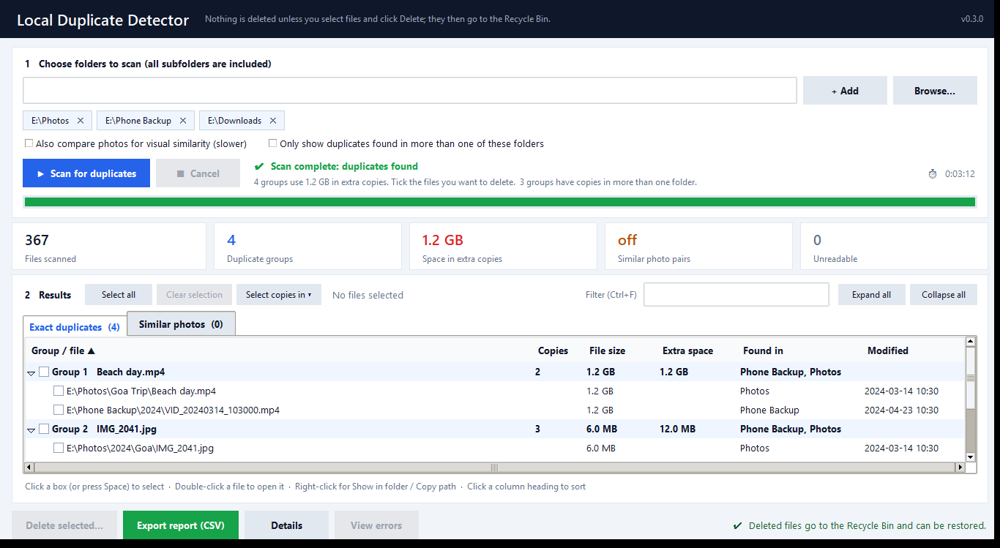
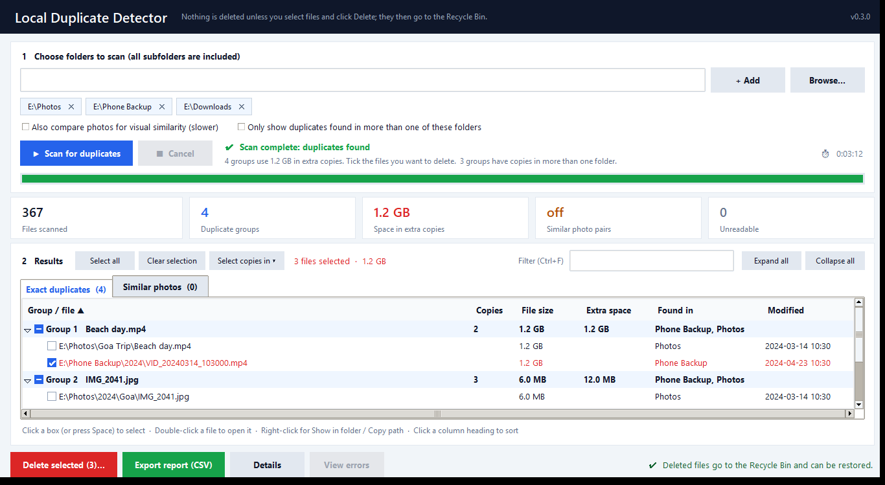
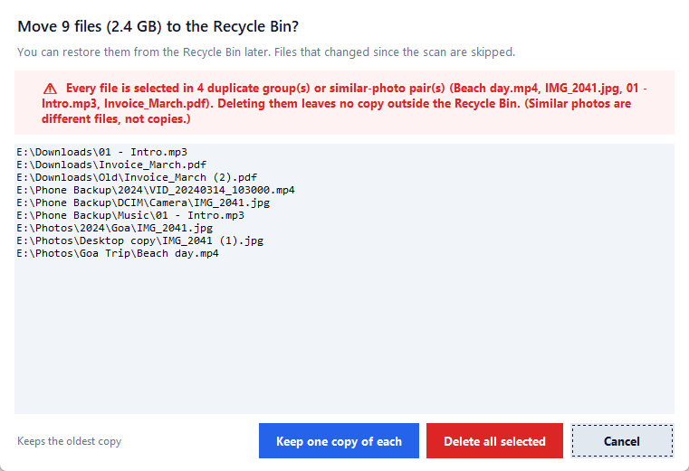

# Local Duplicate Detector

[](https://github.com/gopalthakur71/duplicate-detector/actions/workflows/ci.yml)
[](pyproject.toml)
[](LICENSE)

A desktop tool that finds duplicate files anywhere under a folder or drive, shows how much space the extra copies use, and lets **you** choose which copies to delete. Scanning never changes anything. Files are deleted only when you tick them and click **Delete**, and they go to the **Recycle Bin**, so you can restore them.



## Features

- **Exact duplicates of any file type, whatever their names:** photos, videos, music, documents and so on are compared by the SHA-256 of their contents.
- **One folder or several:** scan a single folder or drive, or add 2, 3 or more folders (even on different drives) and compare them all together. Every folder includes all of its subfolders, however deeply nested. You can show only the duplicates that appear in more than one of your folders.
- **Fast on large drives:** only files that could be duplicates are read.
  1. Files with a unique size are skipped.
  2. Files that share a size are compared by their first 256 KB.
  3. Only files that still match are hashed in full.

  On a typical drive this reads a small fraction of the data.
- **Similar photos (optional):** perceptual hashing (pHash) flags photos that look the same, such as re-saved JPEGs, resized copies, or format conversions. Photos are compared with a pigeonhole index, so even 100,000 of them take seconds to compare.
- **Clear results:** duplicate groups are sorted by wasted space, and every stage shows live progress. You can cancel at any time.
- **CSV report:** includes every file's path, size, modified time, hash, group ID, and a note explaining how it was handled.
- **You choose what to delete:** tick files one at a time, a whole group, or **Select all**, then click **Delete selected**. Nothing is ever selected for you. Deleted files go to the Recycle Bin, files that changed since the scan are skipped, and every deletion is logged.
- **GUI and CLI:** a Tkinter desktop window, plus a `duplicate-detector scan` command for scripting.

## Install

### Windows executable (easiest)
Download `DuplicateDetector.exe` from the [latest release](https://github.com/gopalthakur71/duplicate-detector/releases/latest) and run it. You don't need to install Python.

### From source
Requires Python 3.11 or newer. On Windows, enable **"Add Python to PATH"** during installation.

```bat
git clone https://github.com/gopalthakur71/duplicate-detector.git
cd duplicate-detector
py -m pip install -r requirements.txt
py app.py
```

`requirements.txt` adds Send2Trash (Recycle Bin support) and the optional photo comparison (Pillow, ImageHash).

### As a package
```bash
pip install "duplicate-detector[images] @ git+https://github.com/gopalthakur71/duplicate-detector.git"
duplicate-detector-gui                      # desktop window
duplicate-detector scan E:\ --csv report.csv --images
duplicate-detector scan E:\Photos D:\Backup --across-folders
```

## Usage

1. **Choose one or more folders.** Type a path and press Enter (or click **+ Add**), or click **Browse…**. Each folder appears as a tag, and ✕ removes it. Use `E:\` to scan a whole drive. Subfolders are always included, and a folder inside another chosen folder is only scanned once.
2. Optional settings:
   - Tick **Also compare photos for visual similarity** to find look-alike photos. Exact duplicate scanning is faster without it.
   - With two or more folders, tick **Only show duplicates found in more than one of these folders** to hide duplicates that stay within a single folder. You can change this after the scan.
3. Click **Scan for duplicates**. Use **Cancel** to stop at any time.
4. Review the **Exact duplicates** and **Similar photos** tabs. Expand a group to see its files, click a column heading to sort, or type in **Filter** to narrow by path. The **Found in** column shows which of your folders each copy is in.
5. Double-click a file to open it, or right-click for **Show in folder** and **Copy path**. Press Enter for details, including side-by-side previews of similar photos.
6. **To delete copies:** click the box next to a file, or press Space, to select it. Click a group's box to select all its files, or use **Select all** and **Clear selection**. With several folders, **Select copies in ▾** selects every copy inside one folder (for example `Phone Backup`) that also exists in another of your folders, so the copy elsewhere is always kept. Then click **Delete selected…** and confirm.
   - The confirmation lists every file and its total size.
   - If you selected *every* copy of a file, it warns you and offers **Keep one copy of each**, which keeps the oldest copy.
   - Files go to the Recycle Bin. Files that changed or disappeared since the scan are skipped.
   - A log of everything moved is kept in `%APPDATA%\DuplicateDetector\deletion_log.csv`.

   

   

7. Click **Export report (CSV)** to save the full results. Deleted files are marked in the `notes` column.

Shortcuts: **Enter** to scan, **Esc** to cancel, **Ctrl+F** to filter, **Ctrl+E** to export. The chosen folders and options are remembered in `%APPDATA%\DuplicateDetector\settings.json`.

### Command line

```text
duplicate-detector scan PATH [PATH ...] [--across-folders] [--csv FILE] [--images] [--quiet]
```

Give one or more folders. `--across-folders` reports only duplicates that appear in more than one of them.

Progress is printed to stderr, and a summary and the report path to stdout. Exit codes: `0` for success, `2` for invalid arguments, `130` for a cancelled scan (Ctrl+C).

### CSV columns

| Column | Meaning |
|---|---|
| `source` | Which of the chosen folders the file was found in (or `ERROR` for a read-error row) |
| `path`, `filename` | Full path and file name |
| `size_bytes`, `modified_time` | From the file system |
| `sha256` | Full content hash. Blank when the file was never fully read because it could not be a duplicate |
| `exact_duplicate_group` | Same number means identical contents |
| `possible_visual_matches` | e.g. `possible_pair_3_distance_0` (0 means the photos look identical) |
| `notes` | Why a file was not hashed, or that it had a read error |

## Limitations

- Photo similarity is a review aid, not proof. It can miss heavily cropped or edited copies and can flag photos that merely look alike.
- Videos are found when the copies are identical files. Re-encoded, compressed (e.g. by WhatsApp), trimmed or resized versions of a video are different files and are not matched.
- Large groups of same-size files, such as many identical-size videos, still have to be read in full.
- Empty (0-byte) files are listed in the CSV but not grouped as duplicates.
- Symlinks and junctions are skipped. Files and folders that can't be opened are listed as `ERROR` rows.
- Cloud placeholders (OneDrive / Google Drive "online-only" files) are downloaded when read, or fail with an error. Make them available offline before scanning.

## Development

See [CONTRIBUTING.md](CONTRIBUTING.md). In short:

```bash
uv sync --all-extras
uv run pytest
uv run ruff check . && uv run ruff format --check . && uv run mypy
```

```text
src/duplicate_detector/
  scanner.py   core scan logic (no GUI imports)
  report.py    CSV export
  cli.py       command-line interface
  gui.py       Tkinter interface
tests/         pytest suite
app.py         run-from-source launcher, also the PyInstaller entry point
```

## Safety

- Scanning only reads files. It never writes, moves, or deletes anything.
- Only files **you** select are deleted, and only after you confirm. The app never selects files on its own.
- Deleted files go to the Recycle Bin (Trash on macOS/Linux) and are never permanently deleted. If a drive has no Recycle Bin (some network or USB drives), those files are left in place and reported.
- Each file is re-checked (size and modified time) just before deleting. Anything that changed since the scan is skipped.
- Every deletion is logged in `%APPDATA%\DuplicateDetector\deletion_log.csv`.
- The command-line `scan` command is report-only and never deletes.

Keep a backup of important files anyway.

## License

[MIT](LICENSE)
